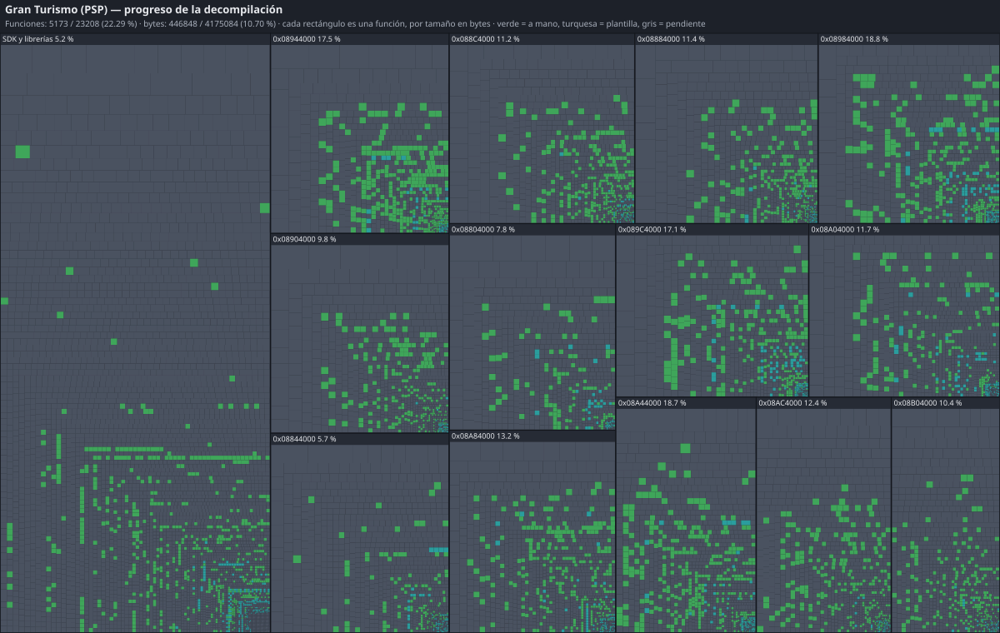

# gran-turismo-decomp

Decompilación de **Gran Turismo para PSP** (2009), versión europea **UCES-01245 v2.00**: reconstruir el
ejecutable del juego (`EBOOT.BIN`, módulo `PDIAPP`) como **C/C++ legible que compila y corre en otras
plataformas** (PC primero), para poder **modificar el juego** desde su código fuente.

Cómo: el ejecutable se traduce entero a C++ con [PSPRecomp](https://github.com/jessicanataliagta/PSPRecomp)
para que el juego corra en PC desde el principio, y después cada función traducida se sustituye por
código decompilado a mano, comprobando que se comporta exactamente igual que la original. No se busca
un binario idéntico byte a byte (los compiladores exactos de Sony no son públicos).

> **Estado (2026-10-10, madrugada) — para leer mañana.**
>
> - **🏁 ¡SE JUEGA UNA CARRERA!** `gt_native` (sin GPU, renderer por software) arranca el juego,
>   reproduce el vídeo de intro, llega al menú (con sus textos) y, pulsando botones simulados, entra en
>   **Single Player → Single Race → elige coche (Peugeot 206 S16 '99) → pista (Apricot Hill Raceway) →
>   parrilla de salida → carrera en 3D** con el HUD (mapa, posición, vuelta).
> - **Verlo tú:** [`docs/COMPILAR.md`](docs/COMPILAR.md) §5 tiene la línea exacta (`GT_PAD=…`,
>   `GT_FRAME_DUMP=recomp/frames`); las imágenes se quedan en tu disco, no se suben. Las fuentes de la
>   PSP las baja `tools/setup.sh` (de PPSSPP, fijadas por hash): **no hace falta instalar PPSSPP**.
> - **🎮 Ya se puede jugar en ventana:** `build/gt_play` (ventana SDL, teclado o mando, a la velocidad de la PSP)
>   llega igual hasta la carrera. Controles y ajustes: [`docs/COMPILAR.md`](docs/COMPILAR.md) §5b.
> - **🔊 Con sonido:** efectos y motor (la mezcla SAS) y la **música** (Atrac3+ decodificada desde los
>   datos que el juego lee de GT.VOL). `GT_AUDIO_DUMP=<dir>` la vuelca a WAV.
> - **💾 Las partidas se guardan y se cargan** (`gt_play` las conserva en `build/savedata/`).
> - **Pendiente visible:** el audio de los vídeos; el backend Vulkan de la GE (hoy se dibuja por software).
> - **Decompilación (Fase 3-4):** 15.950 funciones decompiladas (8.552 de ellas, código que ninguna ruta alcanza, verificadas con casos sintéticos) y probadas contra el original con el
>   harness diferencial (libc: `memset`, `memcmp`, `memcpy`, `memmove`, `strlen`, `strcmp`,
>   `strchrnul`, `bsearch`, la familia printf (`sprintf`, `snprintf`, `vsprintf`, `vsnprintf` y sus «sinks»), y el asignador de memoria entero (`malloc`, `memalign`, `free` y sus 8 auxiliares); motor: el recuento de referencias, el puntero inteligente y los tipos de valor de los scripts;
>   scripts: `MUnit` (8), `MRandom.GetValue`, `Object.toInt/toFloat/defined`, `Math.clamp`,
>   `Module.clearStatic`, `MSystemBGM.getContextSize`, `Array.resize`, `MManager.registerClass`, la
>   interfaz (`setFocus`, `doCopy`, `pushEvent`, `appendChild`…) y el juego (`MOrganizer`,
>   `MRaceOperator`, `MSpecDB.getCarCode`, récords…) y, por la ruta de la carrera, `MCarParameter`,
>   `CarSettings`, `Math.sqrt/abs`, `MSpecDB.isDirt`, `MSound.stopMusic`, menús de opciones,
>   `MCarCollection.hasCar`…), 261 «thunks» de salto (`src/core/thunks.cpp`), 357 funciones triviales de plantilla: vacías, lectores de globales y accesores de miembro (`src/core/trivial.cpp`, `src/core/accessors.cpp`), 138 reenvíos y fábricas de objetos (`src/core/forwarders.cpp`, `src/core/factories.cpp`), 93 constructores, bucles de destrucción y conversiones (`src/core/constructors.cpp`, `src/game/adhoc/try_cast.cpp`) 57 cadenas de llamadas, destructores y listas libres (`src/core/chains.cpp`, `destructors.cpp`, `containers.cpp`) 93 hojas de una o dos instrucciones (`src/core/leaves.cpp`, `chained.cpp`) 13 llamadas virtuales a través de un holder (`src/core/virtuals.cpp`) y 791 funciones pequeñas muy llamadas en la carrera, escritas a mano (`src/game/unsorted/hot_leaves.cpp`: `crc32` de zlib, decodificador UTF-8, reserva alineada, cerrojo anidado, una caché hash de 2048 entradas, un búfer dinámico, accesores…). Todas iguales al
>   original en tres recorridos (carrera, concesionario y garaje/Theatre; `config/pad_routes/`; 0 discrepancias).
>   **1.313 funciones ya tienen su nombre real** (los nativos que usan los scripts Adhoc:
>   `config/symbol_addrs.txt`). Informe: `.venv/bin/python -m tools.progress`.
> - **Probarlo tú:** [`docs/COMPILAR.md`](docs/COMPILAR.md). Detalle en [`docs/ROADMAP.md`](docs/ROADMAP.md).

## Mapa de lo que queda

<!-- progress:start -->
```text
FUNCIONES   ████████████░░░░░░░░░░░░░░░░░░░░░░░░░░░░  28.88 %  6703 / 23208
BYTES       ████████░░░░░░░░░░░░░░░░░░░░░░░░░░░░░░░░  19.52 %  814892 / 4175084
CON NOMBRE  ███░░░░░░░░░░░░░░░░░░░░░░░░░░░░░░░░░░░░░   6.61 %  1534 / 23208
```
<!-- progress:end -->



Cada rectángulo es una función del ejecutable, con área proporcional a sus bytes: verde = decompilada
a mano, turquesa = decompilada con una plantilla, gris = pendiente. Los grupos son tramos de 256 KiB
del código del juego por dirección, y aparte el SDK y las librerías de Sony (frontera aproximada).
Todas las decompiladas están verificadas contra la original con el harness diferencial.

**Versión interactiva** (pasa el ratón por encima para ver nombre, dirección, tamaño y estado, o busca
una función): [`docs/progress/index.html`](docs/progress/index.html) — ábrela en el navegador tras
clonar. Se regenera todo (mapa, página y barras) con `.venv/bin/python -m tools.progress_map`; solo
contiene direcciones, tamaños y nombres propios del proyecto.

## Qué hay y qué no

- **Este repo no contiene datos del juego** — ni ISO, ni ejecutables (cifrados o no), ni assets, ni
  el C++ que genera el recompilador, ni compiladores propietarios. Necesitas **tu propio volcado** del
  UMD.
- El volcado se verifica por hash. El esperado es:

  | Fichero | SHA1 |
  | --- | --- |
  | `Gran Turismo (v2.0) [UCES-01245].iso` | `c84473375e3cd000d8f14c5905e6514389fd6a40` |
  | `EBOOT.BIN` descifrado (ELF) | `8746583fa8298f6447132988a01b236a8c5994b0` |

- **Fuera del alcance**: los scripts Adhoc (ya cubiertos al 100 % por
  [OpenAdhoc](https://github.com/Nenkai/OpenAdhoc)), los assets de `GT.VOL`
  ([GTPSPVolTools](https://github.com/Nenkai/GTPSPVolTools)) y los módulos PRX de Sony.

## Empezar

Guía rápida (Arch Linux; detalle y otros usos en [`docs/COMPILAR.md`](docs/COMPILAR.md)):

```bash
# 0. Una vez: dependencias del sistema
sudo pacman -S --needed git curl unzip 7zip clang cmake ninja uv pkgconf ffmpeg openssl zlib \
                        sdl2 vulkan-icd-loader glslang

# 1. Tu ISO (UCES-01245 v2.00) en game_files/ — se comprueba por hash
cp "/ruta/Gran Turismo (v2.0) [UCES-01245].iso" game_files/

# 2. Herramientas fijadas, extraer el EBOOT y recompilarlo a C++ (todo queda fuera de git)
tools/setup.sh
.venv/bin/python -m tools.extract --full     # --full: también GT.VOL, que el juego necesita
.venv/bin/python -m tools.recomp

# 3. Compilar (≈ 4 min la primera vez; con tope de memoria)
systemd-run --user --scope -p MemoryHigh=5G -p MemoryMax=6G -p MemorySwapMax=0 -- \
  sh -c 'cmake -S . -B build -G Ninja -DCMAKE_CXX_COMPILER=clang++ && cmake --build build -j8'

# 4. Jugar desde la raíz del repo (ventana, teclado o mando, sonido; partidas en build/savedata/)
build/gt_play
```

Controles por defecto: W / Enter = acelerar y aceptar, S = frenar, A / D = girar, flechas = menús,
Retroceso = atrás, Escape = START, F10 = ajustes, F11 = pantalla completa (mando: gatillos + stick).
`build/gt_native` es la versión sin ventana para pruebas y el harness diferencial.

## Para agentes (Claude Code / Codex)

- [`AGENTS.md`](AGENTS.md) es la guía canónica; [`CLAUDE.md`](CLAUDE.md) solo la importa y añade lo
  exclusivo de Claude Code (REA MCP con Ghidra).
- Detalle por tema en [`docs/agents/`](docs/agents/): flujo de decompilación, toolchain, ingeniería inversa,
  testing, verificación en runtime, depuración, orquestación, verificación de PRs.
- Memoria compartida: [`docs/FACTS.md`](docs/FACTS.md) (hechos verificados) y
  [`docs/FINDINGS.md`](docs/FINDINGS.md) (trampas no obvias).

## Créditos y referencias

Trabajo previo de la comunidad en el que se apoya: PSPRecomp (jessicanataliagta) y lcs-recomp
(elmasas), Nenkai (GT Modding Hub, OpenAdhoc, GTAdhocToolchain, GTPSPVolTools), rabbitizer
(Decompollaborate), m2c, ghidra-allegrex (kotcrab), pspdecrypt (John-K), PPSSPP, decomp.me.

Proyecto de investigación sin ánimo de lucro, sin afiliación con Sony Interactive Entertainment ni con
Polyphony Digital. *Gran Turismo* es marca de Sony Interactive Entertainment.
